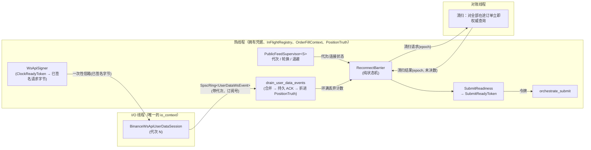

# 私网流迁移、发单就绪门与用户数据流持久化——设计提案

> **状态：提案（PROPOSAL），未被接受，不是规格。** 它把蓝图任务 1A.4（现货私有 WebSocket 用户数据流与会话对账）、审计 P1-002 的路径 ③（用户数据流排空函数）和 FI-043 要求的“屏障门”拆成可以逐片开工、逐片验收的工作，并把需要 Owner 拍板的点列在 §8。每一片开工前仍按 `CLAUDE.md` 的 Tier B 流程出 ≤5 行计划、等“开始”。
> 基线：master `66815bc`（2026-10-13，SAFE-03 切片 2 及其文档同步已合入）。本文只描述现状与设计，没有改动任何代码。
> 读法：§0 是一页摘要；§1 是现状事实（每条带 `file:symbol`）；§2–§6 是设计；§7 是切片计划；§8 是决策点；§9 是风险；§10 是验收映射。

## 0. 一页摘要

**三件事要一起想，因为它们共用同一个结构：“一个连接代次 + 一道屏障 + 一个发单就绪门”。**

1. **私网流在生产现货上已经不能用。** 官方现货变更日志（2026-01-21 条目，蓝图 `5.7` 的 P-07）确认 REST `userDataStream` 三个端点与 WS API 的 `userDataStream.start/ping/stop` 自 2026-02-20 07:00 UTC 起不再提供；树内的 `BinanceUserDataWsSession` 仍连 `/ws/<listenKey>`，续期调度器、`ListenKeyPublisher` 也都围绕这条已下线的路径。今天唯一能工作的成交来源是对账线程的 REST 轮询。
2. **没有“发单就绪门”。** `StartupRecovery::submit_enabled()` 只在测试里被调用，`orchestrate_submit()` 不认它；时钟就绪（SAFE-01）只守住了签名，没有守住发单；FI-043 要求的“自代次 N 断开至代次 N+1 权威对账收敛并发布之前，全部增风险报单被硬拦截”在树里没有对应物。
3. **路径 ③ 只写内存。** `drain_user_data_events()` 把观察写进内存审计环并把成交差分折进 `PositionTruth`，没有任何持久记录（P1-002 剩余的一条）。

**提案**：
- 迁移到 WS API 的**签名订阅**（`userDataStream.subscribe.signature`，HMAC 即可，不依赖 Ed25519），连接代次由现有的 `PublicFeedSupervisor<S>` 管理（它已经有代次、计划性轮换、防抖、排空确认）。
- 加一个纯逻辑的**重连屏障**状态机和一个**类型化的发单就绪令牌**（`SubmitReadyToken`，与 `ClockReadyToken` 同一手法）：只有“流已连上并通过订阅校验、屏障已对账收敛、启动恢复 Ready、时钟就绪、熔断正常”同时成立，才签发令牌，`orchestrate_submit()` 没有令牌就在最前面拒绝。
- 路径 ③ 的持久化走**“持久影子 + 合并发布者”**（§6 的方案 A）：`OrderFillContext` 记下每个订单**最后一次持久确认的状态**，WS 观察先按回放合法性补齐前缀帧、取得持久 ACK，再折进 `PositionTruth`；同一个排空周期里同一订单只落一帧（累计成交量可以合并）。
- 退役 listenKey 整套组件，不让两套会话语义并存（蓝图 1A.4 的明确要求）。

**规模**：我估计 6 片（M0–M5）共 10 至 14 个工作日，其中 M3（屏障与就绪门）和 M2（会话）最重；蓝图对 1A.4 本身的估计是 5 至 9 日，那个数不含就绪门和路径 ③。

**需要你决定的**：§8 的 D1–D8，每条带我的推荐。最先要的是 D8：M0 需要把官方 `web-socket-api.md` 拉到本地核对协议细节（下载需要你的许可）。

## 1. 现状（事实，带 `file:symbol`）

| # | 事实 | 出处 |
| :-- | :-- | :-- |
| F1 | 用户数据流会话连 `stream.binance.com:9443/ws/<listenKey>`，目标路径由 `ListenKeyPublisher` 的快照在 `start()` 时拼出；鉴权完全靠 listenKey 路径，不带签名 | `binance_user_data_ws_session.hpp:BinanceUserDataWsSession::start` |
| F2 | 会话是**失败即停**的：任何错误永久停止该实例，重连由监督器每次新建一个实例完成；监督器**没有代次编号、没有计划性轮换、没有屏障**，只有指数退避 | `binance_user_data_ws_supervisor.hpp:UserDataWsSessionSupervisor::poll` |
| F3 | listenKey 的创建、续期调度、发布都围绕已下线的 REST 端点 | `binance_listen_key_keepalive.hpp:ListenKeyKeepaliveScheduler`、`binance_listen_key_publisher.hpp`、`binance_private_rest.hpp`（listenKey 三个调用） |
| F4 | 事件模型只认三类：`ExecutionReport`、`OutboundAccountPosition`、`ListenKeyExpired`；执行报告**没有取**佣金 `n`、佣金资产 `N`、成交标识 `t` | `binance_user_data_event.hpp:UserDataEventKind`、`binance_user_data_ws_session.hpp:UserDataJsonParser::parse` |
| F5 | 事件经容量 64 的 SPSC 环交给热线程，环满即丢并计数（`push_dropped`），**没有任何“丢了就要对账”的联动** | `binance_user_data_event.hpp:UserDataWsEventRing`、`binance_user_data_ws_session.hpp:on_read` |
| F6 | 热线程的排空函数用 `const InFlightRegistry&` 归属事件，用 `OrderFillContext::consume_delta()` 去重，把正差分折进 `PositionTruth`，再写**内存**审计环；没有持久追加 | `binance_user_data_event.hpp:drain_user_data_events` |
| F7 | 成交的三个来源（直接 POST 回执、REST 对账、WS 执行报告）都经 `OrderFillContext` 去重，它是热线程独占、容量 `kMaxInFlight` 的表 | `order_fill_context.hpp:OrderFillContext` |
| F8 | `StartupRecovery` 是纯状态机，`submit_enabled()` 只在测试中被调用；`OrchestratorContext` 没有接它的字段 | `startup_recovery.hpp:StartupRecovery::submit_enabled`、`live_submit_orchestrator.hpp:OrchestratorContext` |
| F9 | 公共行情侧已有成熟的**代次监督器**：严格递增的代次、计划性轮换（`max_connection_age_ms`）、抖动退避、防抖（`stable_after_ms`）、排空确认回调、`Terminal` 状态；对会话类型泛型，只要求 `start/stop/stopped/is_connected` | `public_feed_supervisor.hpp:PublicFeedSupervisor` |
| F10 | 签名只有 HMAC-SHA256；现货 REST 签名对键值做百分号编码；**WS API 的签名策略（不编码、参数名升序）没有对应代码** | `binance_query_signing.hpp:build_signed_query`、蓝图 `5.2` 的策略矩阵 |
| F11 | 凭据对象把 `sign()`/`copy_api_key()` 钉在创建它的线程上，别的线程调用失败即关闭 | `binance_environment.hpp:BoundHmacCredentials` |
| F12 | SAFE-01 已有类型化许可：`ClockReadyToken`（签名时间戳的唯一来源）、`EndpointPermit`（端点与响应上限）、`RateLimitPermit`（限流归账）；WS API 请求目前没有对应的端点种类与权重 | `binance_clock_sync.hpp`、`transport_policy.hpp`、`spot_rate_limit_budget.hpp` |
| F13 | 对账线程只轮询 `Ambiguous` 与 `Accepted`/`PartialFill` 的订单，按各自的退避节奏；**没有“立刻全量清扫”的入口** | `order_tracker.hpp:poll_once`、`ToReconcileRing` |
| F14 | 持久日志的回放合法性：同一订单只接受“重复同一状态”或 `validate_transition()` 合法的下一帧，否则整本日志 `Corrupt` | `durable_audit_sink.hpp:run_recovery_scan_impl`、`order_lifecycle.hpp:validate_transition` |
| F15 | 对账排空已经是持久优先（SAFE-03 切片 1）：`ReconcileDurablePublisher` 持一个待定事件，队头阻塞，必要时先补一帧 `OrderAmbiguous` 前缀 | `order_tracker.hpp:ReconcileDurablePublisher` |
| F16 | 测试基础设施有本地 TLS WebSocket 服务端，但它**不是 Binance 模拟器**：不读客户端帧、没有订阅协议 | `tests/test_helpers/ws_loopback_server.hpp:WsLoopbackServer` |

## 2. 目标与非目标

**目标**（Stage 1A 的硬前置，蓝图 `1.5.1`、`6.1.4`）：

- G1 生产现货上有一条能工作的私有事件流：签名订阅、订阅校验、24 小时计划轮换、`serverShutdown` 处理、心跳假死检测。
- G2 连接代次与重连屏障：自代次 N 断开至代次 N+1 对账收敛并发布之前，增风险报单被硬拦截；旧代次迟到事件在屏障完成前按累计成交差分收敛、完成后丢弃（FI-043、FI-009、FI-011、FI-020）。
- G3 发单就绪门：把启动恢复、时钟、屏障、熔断汇成一个类型化令牌，`orchestrate_submit()` 缺令牌即拒。
- G4 事件覆盖：执行报告（含 `n`/`N`/`t`）、账户余额变动、余额更新、外部锁定更新、订单列表状态、事件流终止。
- G5 路径 ③ 持久优先：WS 观察先取得持久 ACK 再折进 `PositionTruth`，且不让日志变得不可回放。
- G6 退役 listenKey 整套组件，给出明确处置。

**非目标**：

- 不引入 Ed25519 后端与 `session.logon`（SPOT-03，Owner 已允许但“决策不等于已实施”，默认仍是签名订阅）。
- 不做会计内核（`6.1.7`）对 `n`/`N`/`t` 的入账——本设计只保证这些字段被取下来、不丢；入账是另一个任务。
- 不做撤单/改单路径，不做“增风险/减风险”的订单分类（第一版屏障期间一律拒绝新单，见 D2）。
- 不改 USD-M/COIN-M（合约私网流的协议与路由不同，另议）。
- 不在 CI 里连交易所；真实协议的证据只能由 Owner 用 Testnet 凭据跑出来（见 §9 的 R2）。

## 3. 架构总览



要点：

- **凭据在热线程，I/O 在 I/O 线程。** 签名必须在热线程做（F11），所以订阅请求由热线程签好、放进一个一次性信箱，会话在握手完成后取走并发送；重连时由监督器在热线程重新签（每次重连新时间戳、新签名，永不重放旧的已签名请求——E-06）。
- **代次由监督器分配**，会话在每个事件上盖上自己的代次和订阅号；热线程据此区分新旧。
- **屏障和就绪门都是热线程上的纯逻辑**，只有“清扫”一步要碰对账线程（跨线程交接，TSan 层级）。

## 4. 协议层（WS API 签名订阅）

### 4.1 已核的事实（蓝图 `5.7`，2026-09-29 对官方文档核过）

- P-06：`session.logon` 与会话内 `userDataStream.subscribe` 只接受 Ed25519；`userDataStream.subscribe.signature` 在任意会话中、以任意受支持的密钥类型可用；订阅以 `subscriptionId` 标识；`session.subscriptions` 列出活跃订阅；同一连接同一账户只有一个活跃订阅；WS API 单连接有效期 24 小时。
- P-07：listenKey 三个 REST 端点与 `userDataStream.start/ping/stop` 自 2026-02-20 07:00 UTC 起不再提供。
- P-08：`serverShutdown` 是 JSON 文本帧事件，官方已删除固定提前量的说法，收到后应尽快建立新连接。
- 蓝图 `5.2`：现货 WS API 签名策略 = 排除签名字段、**不做百分号编码**、参数名升序、拼成键值对序列的 UTF-8 字节流；验收要求官方示例向量、仓库内冻结的黄金向量、Testnet 联调三类证据齐备。

### 4.2 **待核**（M0 要拿官方 `web-socket-api.md` 逐条核，核完写回 `5.7` 作为新的 P-编号）

1. WS API 端点与 Testnet 端点（我记得是 `wss://ws-api.binance.com:443/ws-api/v3` 与 `wss://ws-api.testnet.binance.vision/ws-api/v3`，未核）。
2. 订阅请求与响应的确切形状：请求的 `id`、`method`、`params`（`apiKey`、`timestamp`、`recvWindow`、`signature`），响应里 `result.subscriptionId` 的位置与错误码。
3. 事件的包装形状（我记得是 `{"subscriptionId":N,"event":{...}}`，未核）；`serverShutdown`、`eventStreamTerminated` 的确切形状与语义。
4. `userDataStream.subscribe.signature`、`session.subscriptions`、`userDataStream.unsubscribe` 的请求权重（与现货 REST 同一个 `REQUEST_WEIGHT` 限额）。
5. 同一账户能否在**两个连接上同时各有一个活跃订阅**（决定能否做先建后断的重叠轮换，D3）。
6. WS API 的心跳与断线规则（服务端 ping 间隔与 pong 期限）、连接频率限制、`recvWindow` 的上限与默认值。
7. 执行报告里 `n`、`N`、`t` 的确切字段名与类型，`balanceUpdate`、`externalLockUpdate`、`listStatus` 的字段。

### 4.3 代码层（M1）

- `WsApiSigningPolicy`（新，纯函数）：输入已校验的参数集合 + `ClockReadyToken`，输出“签名输入即发送字节”的 `WsApiSignedRequest`（沿用 `build_signed_query` 的手法：单一构造点、保留参数拒绝、签名字节与发送字节同源——E-03）。类型上**只有它能签发** `WsApiSignedRequest`，会话只收这个类型。
- `ws_api_codec`（新，纯函数）：`build_subscribe_signature_request`、`build_session_subscriptions_request`、`parse_ws_api_response`、`parse_user_data_event`（**包装感知**，取代 `UserDataJsonParser`；新增 `BalanceUpdate`、`ExternalLockUpdate`、`ListStatus`、`EventStreamTerminated`、`ServerShutdown` 五个种类，执行报告补 `n`/`N`/`t`）。
- 端点与限流：`EndpointPermit` 目前只管 HTTP 响应的上限（`ResponseKind`），会话连哪个主机也只靠它。WS 会话需要同族的 `WsEndpointPermit`（主机白名单 + 单条消息上限，唯一签发者是 `issue_ws_endpoint_permit`），并把新会话登记进 `test_rest_freeze_guard` 的“所有打开连接的位置”清单——否则会话可以绕过白名单而没有测试发现；WS API 的主机（生产与 Testnet）要加进 `TransportPolicy` 的白名单。限流账本给 WS API 请求另起一个种类枚举与权重（归 Reconciliation 车道，D7）；`PrivateRestEndpoint` 是被 `spec_enum_diff` 钉住的枚举，**不往里加**。
- 事件结构：`UserDataWsEvent` 增加 `generation`（u64）、`subscription_id`（i64）、`commission_raw`/`commission_asset`/`trade_id`；环容量保持 64 或按 §9 的 R5 重估。

## 5. 连接代次、重连屏障与发单就绪门

### 5.1 代次

一个代次 = 一个 WS API 连接 + 它上面经校验的一个订阅。`PublicFeedSupervisor<BinanceWsApiUserDataSession>` 负责：严格递增的编号、失败退避（含抖动与防抖）、24 小时计划轮换（`max_connection_age_ms` 取 23 小时留余量）、排空确认回调（热线程把环里的旧事件消费完、重置每代次状态）。会话的 `is_connected()` **只有在订阅响应成功且 `session.subscriptions` 校验恰好一个订阅之后**才为真——“握手成功”不等于“可用”。

### 5.2 屏障状态机（`ReconnectBarrier`，纯逻辑、无 Boost、可穷举测试）

| 状态 | 含义 | 发单 | 迁出条件 |
| :-- | :-- | :-- | :-- |
| `Down` | 没有已校验的订阅（启动、断线、退避、刚轮换完） | 拦截 | 监督器报告新代次已连接并校验订阅 → `Sweeping` |
| `Sweeping` | 新代次已订阅，正在对**全部**在途订单做权威清扫（立即查询，不按各自退避），并刷新账户快照 | 拦截 | 清扫结果回报：epoch 匹配、每个在途订单都有**晚于清扫开始**的确定答案（已终态或确认存活）、账户快照新鲜 → `Reconciled(G)` |
| `Reconciled(G)` | 代次 G 已对账并发布 | 放行（仍需其他前提） | 任何触发 → `Down` 或 `Sweeping`（见下） |

触发条件：

- **断线 / 监督器离开 `Connected`** → `Down`（FI-043：自断开起就拦截）。
- **计划轮换 / `serverShutdown` / `eventStreamTerminated`** → 视为代次结束 → `Down`（D3 若采用重叠轮换则不同）。
- **环满丢弃计数增加**（F5）→ 同一代次内回到 `Sweeping`（“软屏障”：不重连，只重新清扫）。
- **心跳假死**（超过 `stale_after_ms` 没有任何帧，FI-020）→ 停止会话，走代次结束。
- **疑似执行报告的解析失败**（带 `"e":"executionReport"` 却取不出 `c` 或 `z`）→ 软屏障。

旧代次迟到事件（FI-009）：`Sweeping` 之前与期间，旧代次事件照常经 `consume_delta` 合并（只应用正差分）；`Reconciled(G)` 之后，代次 < G 的事件直接丢弃并计数。

### 5.3 清扫（对账线程的新入口）

对账线程新增一种入口请求 `BarrierSweep{epoch}`：把当时在途的每个订单立刻查询一次（走现有 `QueryPort`，经持久优先的对账排空发布），全部有确定答案后把 `{epoch, 未决数}` 回报热线程。回报用一个小的 SPSC 环（对账线程为生产者），与现有 `ReconcileEventRing` 同一个模式。这是本设计里唯一**新的跨线程共享状态**，所以 M3 要走 WSL2 `thread` 层，并带一个负控（把 acquire/release 降成 relaxed 必须被 TSan 抓到）。

### 5.4 发单就绪令牌

```
SubmitReadiness::authorize(now_ms) -> std::optional<SubmitReadyToken>
  要求同时成立：
    StartupRecovery 为 Ready 且日志健康（sink 开着、未围栏、扫描 Clean/Recovered）
    ReconnectBarrier 为 Reconciled(G)，且监督器当前代次 == G、连接健康
    时钟就绪（issue_clock_ready_token 可签发）
    熔断为 Normal
```

公共行情有效性门（`feed_validity_gate`）**不进令牌**：它回答的是“能不能据此生成新的订单意图”，由规划器自己消费；令牌回答的是“执行侧能不能发出一单”。两道门各管各的，避免把信号侧的问题混进执行侧的授权。

- `SubmitReadyToken` 是不可复制构造的类型（私有构造，唯一签发者是 `SubmitReadiness`，与 `ClockReadyToken` 同一手法）。
- `OrchestratorContext` 加 `SubmitReadiness* readiness`；`orchestrate_submit()` 在最前面（Gate 0）取令牌，取不到 → 新闸门 `OrchestratorGate::NotReady`（附原因枚举，供告警）。**未接线 = 拒绝**，生产线束必须接；测试夹具用一个测试钩子签发；一个文本护栏测试钉死“生产线束的 `OrchestratorContext` 都设置了 `readiness`”（沿用 `test_reconcile_durable_guard` 的手法）。
- 这一个令牌同时收口了 SAFE-01 遗留的“编排器级时钟就绪门”和 SAFE-04 将要提供的熔断状态——它们成为令牌的输入，而不是各自散落的 `if`。

## 6. 路径 ③：用户数据流的持久优先

### 6.1 为什么不是照抄 SAFE-03 切片 1

对账事件自带 `prior_state`（对账线程知道订单当前状态），所以发布者能决定要不要补 `OrderAmbiguous` 前缀。WS 事件到了热线程，热线程**不知道**订单最后一次持久确认的状态：`OrderFillContext` 只有符号、方向、三个精度。而回放合法性要求每一帧都是“同状态重复”或合法转移——例如对最后持久状态是 `Accepted` 的订单补一帧 `Ambiguous` 是非法的（`Accepted → Ambiguous` 不在转移表里），对最后持久状态是 `Submitting` 的订单直接落 `Cancelled` 也是非法的（需要先补 `Ambiguous`）。没有这个信息，WS 路径要么写出会让下次启动 `Corrupt` 的帧，要么永远保守地多写前缀、同样写出非法帧。

### 6.2 方案

| 方案 | 做法 | 优点 | 缺点 |
| :-- | :-- | :-- | :-- |
| **A（推荐）持久影子 + 合并发布者** | `OrderFillContext` 的每个槽位加 `durable_state` 与 `durable_filled`，在**每一处**持久 ACK 之后更新（编排器的 Intent/Prepared/结果帧、对账发布者、WS 发布者）；WS 观察由一个纯函数 `durable_path(from, to)` 算出要补的前缀帧（0 至 2 帧）；同一排空周期里同一订单只保留最新的累计成交量，落一帧；发布者沿用单待定事件、队头阻塞 | 复用既有机制；legality 由一张表决定，可穷举测试；合并后 fsync 次数与订单数而非成交数成正比；`prior_state` 的传递可以逐步收敛到影子 | 影子表是又一份需要和 `InFlightRegistry`/`OrderFillContext` 同生命周期的状态（已有同位调用点，见 `order_fill_context.hpp` 的头注释）；所有 ACK 点都要更新它，漏一处就是不变量破洞——需要护栏测试 |
| B 把 WS 观察转成对账事件 | 热线程把执行报告转成 `ReconcileEvent`，走同一个 `ReconcileDurablePublisher` | 一条持久路径 | 对账事件的 `prior_state` 来自对账线程的跟踪器，热线程拿不到同一份；要么跨线程取、要么也要影子 |
| C WS 只当提示 | WS 事件只写内存审计环并“唤醒”对账线程立刻 REST 查询该订单，仓位只由对账路径更新 | 最简单，持久路径唯一；没有第三个成交来源 | 成交延迟多一次 REST 往返；对账线程的查询权重（`GET /api/v3/order` 为 4）随成交频率上升；`n`/`N`/`t` 这类逐笔字段 REST 订单查询给不了，会计内核以后仍然需要 WS 或 `myTrades` |

**推荐 A，C 作为后备。** 若 M4 实现时发现影子的维护面太大，可退到 C：它不破坏任何不变量，只是更慢、更费权重。

### 6.3 A 的要点

- 影子更新点（均在热线程，且只在持久 ACK 之后）：`orchestrate_submit` 的 Gate 10b（Intent）、Gate 12d（Prepared → Submitting）、Gate 13 的各结果分支；对账发布者的 ACK；WS 发布者的 ACK；`apply_recovery`。
- **恢复路径的播种是最容易错的一点**：检查点只告诉我们“恢复成 `Ambiguous`”，并不告诉我们日志里最后一帧是 `Submitting` 还是真的 `Ambiguous`（`OrderRecoveryCheckpoint` 是 ABI 钉住的布局，不为此加字段）。SAFE-03 切片 1 的做法是对 `prior_state == Ambiguous` 的订单一律先补一帧 `Ambiguous` 前缀——从 `Submitting` 和从 `Ambiguous` 出发都合法。影子沿用同一个保守规则：恢复出的订单播种为 `AmbiguousMaybeSubmitting`（一个只用于影子的伪状态），`durable_path` 对它总是先补 `Ambiguous`，第一次 ACK 之后影子才变成确切状态。
- `durable_path(from, to)`：`Submitting → {Cancelled, Expired, CancelRequested}` 补 `Ambiguous`；`Accepted/PartialFill → Ambiguous` 永不补；`Intent` 不应出现在 WS 观察之前（订单已发出至少意味着 `Submitting` 已落盘）；不可达的组合 = 拒绝落盘并计数（失败关闭，由屏障触发对账兜底）。
- 帧内容沿用既有 `OrderEvent` 帧与 `AuditRecord`（事件类型用既有的 `UserDataStreamEventObserved` 或 `OrderReconciled`），**不新增持久记录类型**（`DurableRecordType` 是被 CI 钉住的封闭枚举）。
- 影子的失败模式：**超前**是不变量破洞（ACK 之前就更新了影子，之后据此补的前缀会是非法帧）——所以更新只发生在 ACK 之后，并由“追加失败则影子不变”的测试与变异体钉死。**落后**（有一处写盘没有更新影子）同样会让之后的帧非法——这正是 R8 要用护栏测试逐点钉死的。`durable_path` 遇到表里没有的组合时拒绝落盘并计数（失败关闭），由软屏障交给 REST 对账兜底，而不是猜一个前缀。

## 7. 切片计划

| 片 | 内容 | Tier | 验证层级 | 估计 |
| :-- | :-- | :-- | :-- | :-- |
| **M0** 协议核对 | 拉官方 `web-socket-api.md`（需许可），核 §4.2 的 7 项，写入蓝图 `5.7`（新的 P-编号）；整理 WS API 签名的官方示例向量 | A | 文档核对（`tools/closure_ledger_check.py`、站点四层检查） | 0.5 日 |
| **M1** 编解码与签名 | `WsApiSigningPolicy`、`ws_api_codec`、新事件种类与字段、`EndpointPermit`/限流的 WS API 种类（不动被钉住的枚举） | B（新组件） | MSVC + WSL2 `none` + `address`；黄金向量 + 官方示例向量 + 篡改一位必须验签失败的负向对照；变异检查 | 2 日 |
| **M2** 会话 | `BinanceWsApiUserDataSession`（握手后取信箱里的已签名字节、发订阅、校验响应与 `session.subscriptions`、读循环、盖代次、`serverShutdown`/`eventStreamTerminated` 处理、失败即停）；`WsLoopbackServer` 扩展为可读客户端帧的脚本化应答；监督器接线 | B（并发） | WSL2 `thread`（信箱交接，带负控）、`address`；回环服务端覆盖：订阅成功/失败/超时、重复订阅、断线、`serverShutdown` | 3 日 |
| **M3** 屏障与就绪门 | `ReconnectBarrier`、对账线程的 `BarrierSweep` 入口与回报环、`SubmitReadiness`/`SubmitReadyToken`、`OrchestratorGate::NotReady`、护栏测试；现有约百个编排器测试通过夹具里的一处测试钩子接线，不逐个改；`StartupRecovery` 第一次被真正接进线束（预检线束）；FI-009/011/020/043 的确定性状态机测试 | B（状态机 + 并发） | WSL2 `thread`（两个负控仍须失败，另加清扫回报环的负控）+ `address`；变异检查；`formal/` 新增屏障模型（见 §9 的 R9） | 4 日 |
| **M4** 路径 ③ 持久优先 | `OrderFillContext` 影子、`durable_path`、WS 合并发布者、`drain_user_data_events` 改造、影子更新点的护栏 | B | WSL2 `address` + `thread`（若发布者与排空共用待定事件）；真实日志重启测试；变异检查 | 2 日 |
| **M5** 退役与联调 | 删除 listenKey 整套（`ListenKeyPublisher`、续期调度器、`BinanceUserDataWsSession`、旧监督器、REST listenKey 调用与端点种类、对应测试），迁移 `live_submit_reconcile_harness_demo` 与预检线束；**Owner 用 Testnet 凭据跑联调**并贴日志 | B | 全量三层 + CI 手动 Sanitizer；Testnet 联调由 Owner 执行 | 2 日（不含联调等待） |

合计 13.5 日的上限；M0 可以和 M1 并行；M4 与 M3 几乎没有依赖，可以交错。**每一片都是一个独立 PR，每个 PR 都带它自己的变异检查与回归。**

## 8. 需要你决定的点

| # | 决定 | 选项 | 我的推荐 |
| :-- | :-- | :-- | :-- |
| D1 | 订阅方式 | 签名订阅（HMAC 可用）；或先做 Ed25519 与 `session.logon` | **签名订阅**（蓝图已定；Ed25519 另走 SPOT-03） |
| D2 | 屏障期间拦截范围 | 一律拒绝所有新单；或区分增风险/减风险（需要仓位感知的分类） | **第一版一律拒绝**——树里没有撤单与减仓路径，分类没有对象；以后再放宽 |
| D3 | 24 小时轮换与 `serverShutdown` | 先断后建（复用 `PublicFeedSupervisor`，屏障兜底）；或先建后断的重叠（新旧两个连接同时订阅，需 §4.2 第 5 项为真） | **先断后建**：正确性由屏障保证，窗口是重连 + 清扫的时间；等 Testnet 量出窗口再决定要不要优化 |
| D4 | 路径 ③ 的持久方案 | A 影子 + 合并发布者；B 转成对账事件；C 仅作提示 | **A**，C 作后备（§6.2） |
| D5 | listenKey 整套 | M5 直接删除；或留着给 Testnet | **删除**（先核对 Testnet 是否仍支持，M0 顺带核；git 历史保留，避免两套会话语义并存） |
| D6 | 清扫由谁执行 | 对账线程（新入口 + 回报环）；或热线程同步查询 | **对账线程**：热线程已经有同步 POST，不该再叠 64 个同步查询 |
| D7 | WS API 请求的限流车道 | Reconciliation 车道；或独立车道 | **Reconciliation 车道**（订阅与校验属于对账类流量），权重以 M0 核到的为准 |
| D8 | **许可** | 允许我下载官方 `web-socket-api.md`（来源 `raw.githubusercontent.com/binance/binance-spot-api-docs/master/web-socket-api.md`，约几百 KB，存入会话草稿目录，核完删除） | 请允许；这是 M0 的前提 |

## 9. 风险与未知

- **R1 协议细节未核**（§4.2 的 7 项）：M0 在写任何代码之前核完；核不出来的项按“最保守”处理并在代码里留断言。
- **R2 真实协议证据只能由 Owner 产生。** `CLAUDE.md`：AI 会话不处理真实凭据、不提交真实订单。CI 里只有回环服务端；Testnet 联调（M5）由你用 Testnet 凭据运行，我提供线束与判据。回环测试证明“我们的客户端按我们理解的协议行事”，不证明“我们理解对了协议”——这条差距只有联调能补。
- **R3 新的跨线程状态**：信箱（热线程 → I/O 线程）、清扫回报环（对账线程 → 热线程）。两处都按既有 SPSC/一次性交接的模式，各带 TSan 负控。
- **R4 同步 fsync 进入 WS 排空路径**：合并后 fsync 次数与订单数成正比，但仍在热线程上；时延未测量（与 SAFE-03 切片 1 的遗留同源，`seg.budget` 仍缺）。
- **R5 环容量 64 与丢弃**：突发期间（重连后回放的积压、一笔订单大量分笔成交）可能丢事件；设计上丢弃 = 软屏障，所以不是静默丢失，但会短暂拦截发单。容量是否要加大由 Testnet 实测决定。
- **R6 屏障期间的拦截时长**：重连 + 订阅校验 + 清扫（最多 `kMaxInFlight` 次查询，权重 4 each = 256，在 Reconciliation 车道预算内要核）。若量出来是秒级，D3 的重叠轮换值得做。
- **R7 24 小时轮换与行情节奏**：轮换点应避开整点 K 线收盘（公共侧的 `BoundaryFn` 已有同样的需求），否则屏障正好压在信号时刻。
- **R8 影子表的维护面（方案 A）**：所有持久 ACK 点都要更新它；漏一处就是不变量破洞。缓解：护栏测试逐点钉死、变异检查“漏更新一处”。
- **R9 形式化模型**：蓝图要求并发/状态机类改动配 TLA+ 模型。屏障 + 代次 + 就绪令牌值得一个小模型（状态：代次、屏障态、在途订单的已知度；不变量：令牌签发 ⇒ 该代次已对账；负控：删掉“断线即 Down”必须违反不变量）。放在 M3。
- **R10 与 SAFE-04 的接口**：就绪令牌需要熔断状态作输入；SAFE-04 尚未开工。M3 先把熔断当作现有内存态读取（接口留好），SAFE-04 完成后替换为带持久锁存的版本。
- **R11 规模估计的不确定度**：协议核对、回环服务端扩展、屏障的跨线程交接都有未知；我给的是上限，不是承诺。

## 10. 验收映射

| 用例 | 判据 | 落点 |
| :-- | :-- | :-- |
| FI-043 代次 N→N+1（含 `serverShutdown` 与 24 小时轮换） | 自断开至 `Reconciled(N+1)` 之间 `orchestrate_submit` 返回 `NotReady`；旧代次迟到事件按累计成交差分收敛，只应用正差分 | M3 状态机测试 + 回环端到端 |
| FI-009 旧连接迟到事件 | `Reconciled(G)` 之后代次 < G 的事件被丢弃并计数；之前被合并 | M3 |
| FI-011 `serverShutdown` | 收到即触发代次结束与新连接；新代次对账收敛后才放行 | M2（会话识别）+ M3（屏障） |
| FI-020 私有数据流心跳假死 | 超过 `stale_after_ms` 无帧 → 数据状态陈旧、会话重建、屏障回到 `Down` | M2 + M3 |
| 新增：环满丢弃 → 软屏障 | 丢弃计数增加 → 同代次回到 `Sweeping`，对账完成后恢复 | M3 |
| 新增：影子不超前 | ACK 之前影子不变；任一 ACK 点漏更新被护栏/变异体抓到 | M4 |
| 新增：WS 路径写出的日志可回放 | 真实 `DurableAuditSink` 重启回放不 `Corrupt`（含 `Submitting` 恢复后收到 `CANCELED`） | M4 |
| P1-002 路径 ③ | `drain_user_data_events` 先持久 ACK 再折进 `PositionTruth` | M4，合并后 P1-002 可由 `PARTIAL` 转 `CLOSED` |

---

**下一步（等你表态）**：D1–D8。D8 是最先的——M0 不需要任何代码，只要许可就能开始；M1 起每片按 Tier B 出计划等“开始”。
